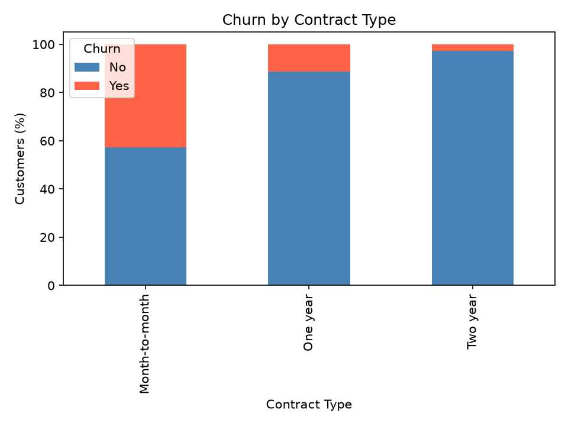
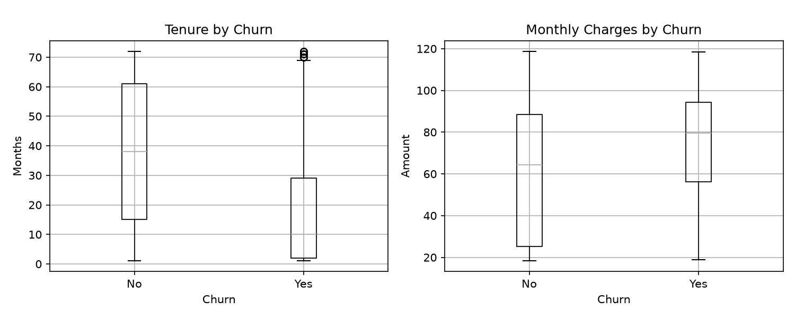
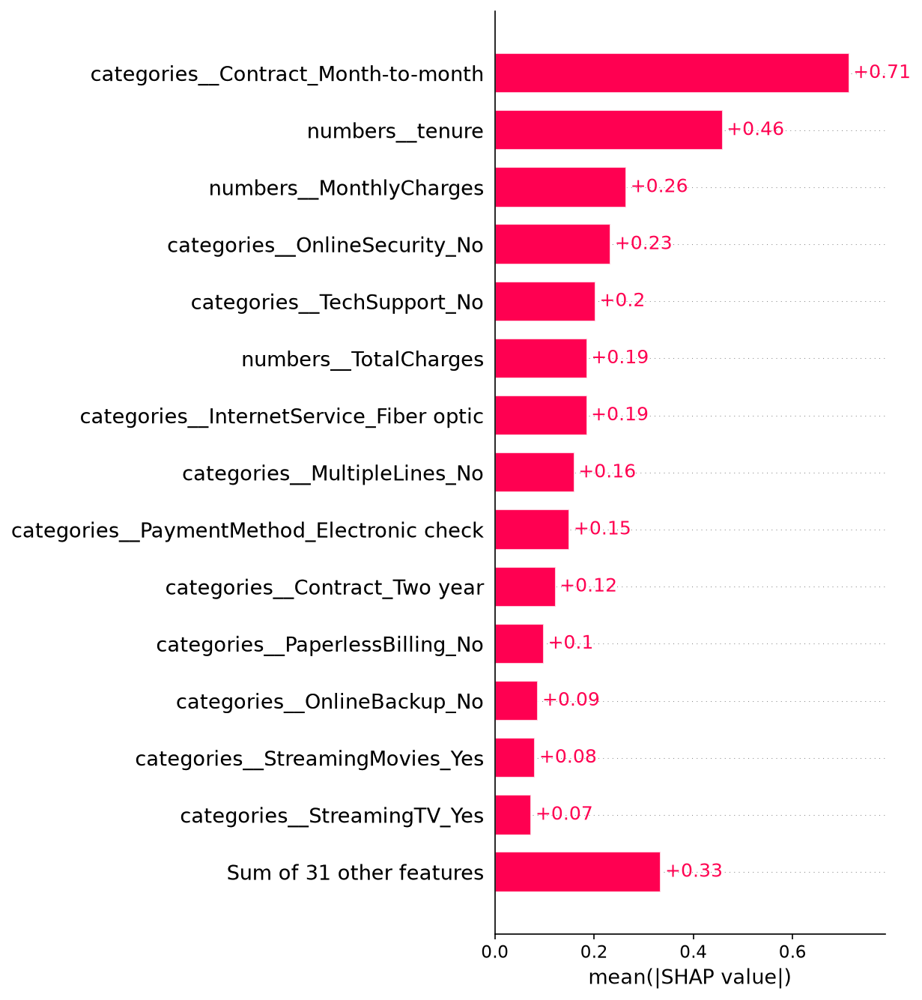
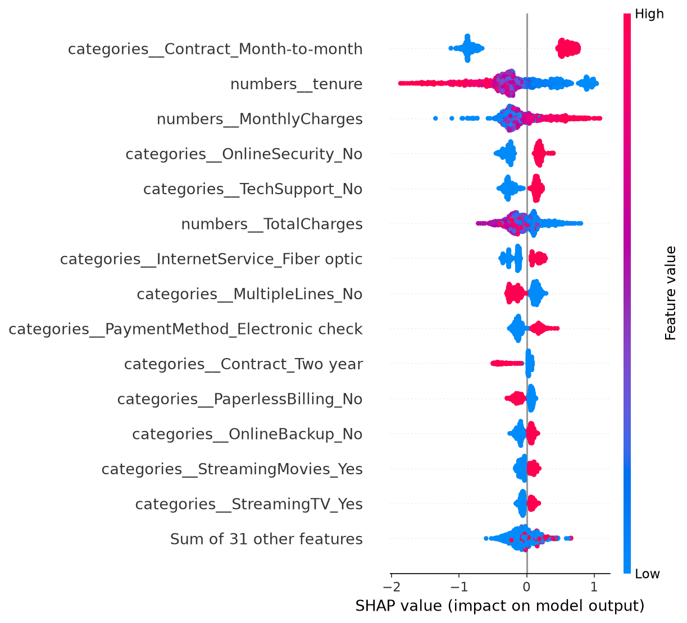

# Telecom Customer Churn Prediction

Predicting which telecom customers are likely to leave, comparing a logistic regression baseline with XGBoost, explaining the model with SHAP, and exploring the results in a Streamlit dashboard.

## Why this matters

Keeping an existing customer is usually cheaper than acquiring a new one. A churn model helps a telecom team decide **which customers to prioritise for outreach**, while balancing the cost of contacting customers who would have stayed anyway.

## Dataset

IBM's **Telco Customer Churn** dataset (7,043 customers, 21 columns): demographics, account details, subscribed services, and whether the customer churned.

- Download from [Kaggle](https://www.kaggle.com/datasets/blastchar/telco-customer-churn)
- Place `WA_Fn-UseC_-Telco-Customer-Churn.csv` in the `data/` folder

## Approach

1. **Cleaning:** `TotalCharges` is stored as text; converted to numeric, and the 11 rows where it is blank (customers with tenure 0) are dropped.
2. **EDA:** churn by contract type, tenure and monthly charges by churn status.
3. **Preprocessing:** `StandardScaler` on numeric columns, `OneHotEncoder` on categorical columns, inside a scikit-learn `Pipeline` so scaling and encoding are fitted on training data only (no leakage).
4. **Models:** logistic regression (baseline) and XGBoost (300 trees, depth 3, learning rate 0.05), on the same stratified 80/20 split (`random_state=42`).
5. **Evaluation:** accuracy, churn precision, recall, F1, ROC-AUC and average precision. Because only about a quarter of customers churn, accuracy alone is misleading.
6. **Explainability:** SHAP values for the XGBoost model.

## Results

Evaluated on a held-out 20% test set (stratified, `random_state=42`) at the default 0.5 threshold.

| Model | Accuracy | Churn precision | Churn recall | Churn F1 | ROC-AUC | Avg. precision |
|---|---|---|---|---|---|---|
| Logistic regression | 0.804 | 0.648 | 0.572 | 0.608 | 0.836 | 0.623 |
| XGBoost | 0.796 | 0.636 | 0.543 | 0.586 | 0.836 | 0.649 |

**Takeaways**

- Both models rank customers about equally well (ROC-AUC 0.836). The simple logistic regression baseline is slightly better on accuracy, recall and F1 at the 0.5 threshold, while XGBoost has a higher average precision (0.649 vs 0.623), so it is a little better at placing true churners at the very top of the risk list. Without tuning, the more complex model does not clearly win.
- Recall is the weak spot: the models catch roughly 54-57% of churners, so more than 40% of customers who leave are missed at this threshold. Lowering the threshold would catch more churners at the cost of contacting more customers who would have stayed.
- In the data, month-to-month customers churn far more than customers on one- or two-year contracts (about 4 in 10 month-to-month customers left, versus roughly 1 in 10 on one-year and a few percent on two-year contracts).
- SHAP (XGBoost) ranks **month-to-month contract**, **tenure** and **monthly charges** as the most influential features, followed by having no online security or tech support and fiber optic internet. Short tenure and a month-to-month contract push predictions toward churn; a two-year contract pushes them away.

### Visuals






Dashboard screenshot: save one as `images/dashboard.png` and add `` here.

## Project structure

```
telco-churn/
├── app.py              # Streamlit dashboard
├── customerchurn.py    # EDA, model training, SHAP plots
├── churn_model.py      # Shared data loading and modelling code
├── requirements.txt
├── data/               # put the CSV here
└── images/             # saved plots
```

## Run it

```bash
git clone <your-repo-url>
cd telco-churn
python -m venv .venv
.venv\Scripts\activate        # Windows  (macOS/Linux: source .venv/bin/activate)
pip install -r requirements.txt

python customerchurn.py       # analysis + SHAP plots
streamlit run app.py          # dashboard
```

## Limitations

- The dataset is a single snapshot and the results are patterns, not proof of cause. SHAP shows what the model learned, not what makes customers leave.
- Default 0.5 decision threshold; a real deployment would choose a threshold based on the cost of a missed churner versus an unnecessary retention contact.
- No hyperparameter tuning or cross-validation yet. Both are natural next steps.

## Tech stack

Python, pandas, scikit-learn, XGBoost, SHAP, matplotlib, Streamlit
